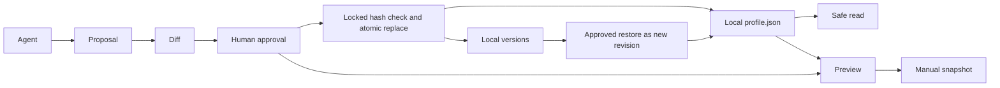

# Design decisions
The restored master task is the specification. The user explicitly requested direct implementation without another design approval round. Python standard library plus one atomic JSON envelope gives a small auditable offline system. A database adds deployment burden; Git as the fact store complicates consent. Git is optional.

The canonical JSON includes audit metadata. Write history before canonical replacement. A crash may leave an orphan version; later revisions skip occupied numbers. History mismatch blocks writes. Cooperating writers serialize by exclusive lock; hostile same-user writers are outside this portable protocol. Never auto-delete stale locks.
Tree changes: behavior tests are grouped by feature in test_bridge.py/test_security.py; no dependabot without dependencies. CODEOWNERS is deliberately unassigned pending confirmed maintainer. Source skill stays under skills/. Optional project-local discovery copies are only for validation.
